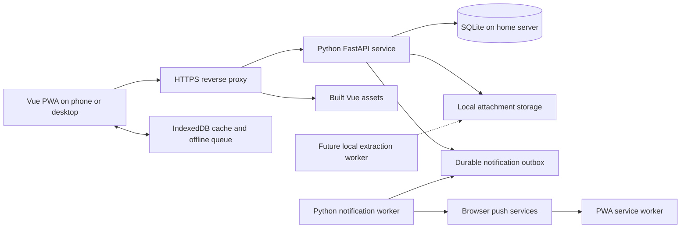

# PigPen architecture

## 1. Status and boundaries

This is a proposed implementation architecture for the confirmed requirements in [functionality.md](functionality.md). Python, FastAPI, Vue, a home-server-local SQLite database, and a responsive PWA are confirmed. Specific libraries, deployment tooling, and the schema below are proposals.

The initial deployment serves one household. Model household membership explicitly to support more than two profiles without implementing a public multi-household service.

The browser cache is a subset of shared server data plus pending operations. The server remains authoritative. Browsers never open the shared SQLite file directly.

## 2. Frontend

Use Vue with TypeScript, client-side routing, and a production asset build. Proposed screens are onboarding/profile selection, dashboard, monthly budget, purchases and purchase detail, income/savings, recurring bills, wish lists, approvals, notifications, and profile/settings.

Use a manifest and pig-themed app icons for installation. A service worker caches the application shell and handles push events. Keep structured financial records and pending writes in IndexedDB. Do not indiscriminately cache API responses or attachments in the service worker.

Separate server-confirmed state from local pending state. Budget totals should identify the effect of unsynchronized purchases rather than presenting it as confirmed shared spending. Profile switching changes the active identity but must not relabel queued actions.

Use responsive layouts, visible input labels, keyboard support, and touch-friendly controls. Never rely on color alone to distinguish approval or synchronization status.

## 3. Backend and persistence

FastAPI exposes versioned JSON endpoints and validates all amounts, category relationships, actor membership, and state changes. Use a service layer for budget calculations, approvals, recurrence, and synchronization so clients cannot bypass rules by calling endpoints directly.

Use SQLite on a local disk of the Omarchy home server. Enable foreign keys, short write transactions, a busy timeout, and WAL mode. Processes accessing the database must run on the same host; WAL does not support a database shared across machines through a network filesystem. See [SQLite WAL documentation](https://www.sqlite.org/wal.html).

Proposed persistence tooling is SQLAlchemy with migrations managed by Alembic. Start with a small server process count; handle concurrent edits with revisions rather than assuming requests arrive serially. Each domain write, audit event, change-log entry, and notification-outbox entry must commit atomically.

Store money as integer minor units, never binary floating-point. Store UTC event timestamps and explicit local transaction dates. Determine monthly membership from the transaction date in the household timezone. Use application-generated UUIDs for records created offline.

## 4. Proposed data model

All domain records belong to a household directly or through an enforced parent relationship. Mutable synchronized records carry a monotonically increasing revision and timestamps. Deleted records need tombstones for synchronization.

| Entity | Main fields and purpose |
| --- | --- |
| households | Name, currency, timezone, expected monthly income defaults. |
| users / memberships | Display name, avatar key, active status, household membership. |
| categories | Household, name, kind (expense, savings, personal), optional owner, optional Personal parent, archived status. |
| budget_months | Household, calendar month, expected income for that month; unique per household/month. |
| allocations | Budget month, category, allocated minor units; unique per month/category. |
| purchases | UUID, household, purchaser, item/service, amount, category, local transaction date, merchant, description, optional request/bill occurrence link, revision, deletion marker. |
| income_entries | Household, attributed user, description, amount, local date. |
| savings_entries | Opening amount, contribution, or withdrawal; amount, date, actor, optional note. |
| recurring_bills | Name, amount, category, recurrence rule, due day, next occurrence, active status. |
| bill_occurrences | Bill, due date, expected amount, optional linked purchase; unique bill/due date. |
| wishlist_items | Owner, name, price, description, URL, active/purchased/archived status. |
| approval_requests | Requester, item, estimated amount, description, URL, optional category, lifecycle status, request revision. |
| approval_votes | Request, reviewer, boolean approval, reviewed request revision, vote revision; unique request/reviewer. |
| comments | Actor, text, timestamp, reference to a wish-list item or approval request. |
| attachments | Purchase, generated storage key, original display filename, media type, byte size, checksum, uploader. |
| installations / push_subscriptions | Installation identifier, selected profile, endpoint/keys, permission state, active status. |
| notifications | Recipient, event type, referenced record, read timestamp, unique event/recipient key. |
| notification_outbox | Event and recipient/subscription, retry state, attempts, next attempt time. |
| audit_events | Actor, operation, target, server time, original client time, relevant change details. |
| sync_operations | Household, operation UUID, actor, payload hash, stored outcome for retry deduplication. |
| change_log | Monotonic cursor, affected entity, entity ID/revision, deletion marker. |

Enforce that only a Personal parent accepts subcategories, children share the parent's owner, and children cannot themselves have children. Ordinary purchases use expense or Personal categories. Savings contributions use savings entries rather than being counted as ordinary expenses. Savings entries feed the Savings category's actual contribution display.

For Personal reporting, aggregate direct parent purchases and child purchases exactly once. Household allocation totals include each user's parent Personal allowance, never child allocations. Preserve category/owner relationships when archiving.

## 5. Budget calculations

- Expense-category remaining = monthly allocation minus non-deleted purchases assigned to that category in the month.
- Personal remaining = parent allowance minus direct Personal purchases minus all child purchases for that owner/month.
- Savings allocation remaining = intended monthly contribution minus recorded net contributions for the month; distinguish this from money available to spend.
- Actual monthly income = sum of income entries in that month.
- Planned unallocated income = expected monthly income minus category allocations, including personal allowances and savings allocation.
- Recorded savings = dated opening amount plus contributions minus withdrawals through the selected date.

Do not count planned recurring bills as paid purchases or expected income as actual receipts. This is a manual budget tracker, not a bank ledger; avoid implying a verified cash balance.

## 6. API surface

Proposed routes live under `/api/v1`. List endpoints support pagination and appropriate month/category/user filters. FastAPI's generated OpenAPI document describes final request/response contracts during implementation.

| Resource | Operations |
| --- | --- |
| `/household`, `/users` | Read settings; list/create/edit/archive profiles; select the installation's active profile. |
| `/categories` | List/create/rename/archive categories and Personal subcategories. |
| `/budget-months/{month}` | Read/init monthly budget and update expected income/allocations. |
| `/purchases` | List/create/read/edit/delete purchases. |
| `/purchases/{id}/attachments` | Upload/list/delete attachments; download through a controlled endpoint. |
| `/income`, `/savings` | Manage dated entries. |
| `/recurring-bills`, `/bill-occurrences` | Manage definitions, list due bills, record/link payments. |
| `/wishlist-items` | Manage items and lifecycle state. |
| `/approval-requests` | Create/read/revise/cancel requests; link a recorded purchase. |
| `/approval-requests/{id}/vote` | Set the acting reviewer's explicit desired boolean with expected request/vote revisions. |
| `/comments` | List/create comments for supported records. |
| `/notifications` | List notifications and mark read. |
| `/push-subscriptions` | Register/update/deactivate an installation's subscription. |
| `/sync/push`, `/sync/pull` | Submit queued operations and fetch incremental changes from a cursor. |
| `/health` | Basic readiness without exposing household data. |

Online and queued mutations use the same domain services and operation deduplication rules. Validation errors must identify actionable fields; conflicting revisions return a conflict with the current record. The actor is an explicitly selected household member, not an authenticated principal in version 1.

## 7. Offline synchronization and approval consistency

An operation envelope contains an operation UUID, entity UUID, acting user, operation type, payload, client time, and expected revisions where applicable. Queue it durably before indicating that an offline action is saved.

1. On reconnect or foreground, send pending operations in dependency order. An offline request creation must precede a vote or linked purchase referring to it.
2. Validate the actor and current category/request state. An archived category or user produces a resolvable failure, not reassignment.
3. Check the operation UUID. A previously accepted identical operation returns its original result. Reuse with different content is rejected.
4. Apply a valid operation with its audit/change/outbox records in one transaction.
5. Mark confirmed operations locally, then pull changes using the server cursor. Do not advance past unprocessed changes.
6. Retain conflicting/rejected operations and show recovery choices to the user. If the cursor is no longer available, replace the confirmed cache from a fresh snapshot while preserving the pending queue.

Approval writes send `approved: true` or `approved: false`, never a blind "toggle" command. A retry must not reverse a vote. Votes reference the exact request revision reviewed. Substantive request edits invalidate old approvals. Concurrent changes to the same vote or a revised/canceled/purchased request require review; do not silently accept stale approval intent. Independent reviewers may vote on the same unchanged request without conflicting with each other.

When linking a purchase to a request, the server atomically checks confirmed approval, request revision/lifecycle, and whether a purchase is already linked. An offline purchase linked to a request remains pending until this check succeeds. Ordinary manual purchases can still be recorded without an approval link.

Retain operation deduplication records in version 1 so a long-offline retry cannot recreate a deleted purchase. Incremental pulls include tombstones. Background Sync is optional; reconnect/foreground/manual sync must be sufficient.

## 8. Notifications and local processing

Create in-app notifications and durable push jobs from committed domain events. A worker sends Web Push and retries temporary failures without duplicating inbox entries. Remove subscriptions that the provider reports as expired. Record delivery attempts separately from read state; push delivery is not proof of approval or viewing.

Reassign a device subscription when its selected profile changes; resolve recipient binding before sending queued push work so a previous profile's notifications are not sent to that installation. Minimal push payloads link to records loaded from the app.

Browser push uses service workers and requires a secure context and user permission. See [MDN Push API](https://developer.mozilla.org/en-US/docs/Web/API/Push_API) and [Notifications API](https://developer.mozilla.org/en-US/docs/Web/API/Notifications_API/Using_the_Notifications_API). Apple-specific behavior should be checked against [Apple Web Push documentation](https://developer.apple.com/documentation/usernotifications/sending-web-push-notifications-in-web-apps-and-browsers) during device testing.

Financial storage and future OCR remain local, but standard browser push uses browser-vendor push services and requires outbound connectivity. This dependency should be explicit in deployment documentation. The application itself and its offline queue continue to work without successful push delivery.

Future extraction should use a local worker with persisted job state. Store extracted suggestions separately from confirmed purchases and require user review. No OCR or LLM service is necessary for version 1.

## 9. Home-server deployment and operations

Proposed deployment: serve the built Vue frontend and reverse-proxy FastAPI under one HTTPS origin. Run FastAPI and the notification worker as supervised services on the existing Omarchy machine. Store SQLite, uploads, and backups in dedicated persistent directories outside the source tree. Do not alter desktop configuration as part of app development.

HTTPS is needed on phones accessing the home server; another device connecting to a plain HTTP LAN address does not inherit localhost exceptions. Choose the hostname/certificate method before device testing. LAN-only access is the initial proposal; remote access is an unresolved deployment decision. Free profile switching assumes trusted access to the home service.

Keep database files, attachments, push private keys, and configuration out of version control. Use generated attachment paths, validate image types and sizes, and serve uploads through controlled routes. Render user descriptions/comments as text. Validate optional links as HTTP(S) URLs. Avoid logging financial payloads or subscription keys.

Back up the database using SQLite's backup API or another transaction-consistent method, together with attachments and required secrets. A raw copy of the main database file while WAL writes are active is insufficient. Coordinate attachment deletion and backup so snapshots do not refer to missing files. Proposed retention is seven daily and four weekly backups, preferably with another copy off the server; confirm destination and retention before configuring jobs. Test restoration before considering deployment complete.

## 10. Release verification

Implementation should verify behavior at the boundaries where mistakes affect shared records:

- First-run profile creation, automatic Personal category creation, remembered identity, profile switching, and original-actor preservation in queued operations.
- Monthly isolation, precise money arithmetic, Personal rollups, category archive history, and savings/expense separation.
- Recurring bill occurrence deduplication and recording a payment exactly once.
- Requester cannot approve their own request; approval on/off emits committed events; request edits invalidate previous votes.
- Duplicate sync retries do not duplicate purchases, payments, comments, or notification records.
- Offline request/purchase creation, offline approval intent, stale-vote conflicts, archived categories, and interrupted synchronization.
- Push permission denied, subscription switching, expired endpoints, server restarts, and reconnect without background sync support.
- Mobile/desktop layouts, keyboard interaction, PWA installation, offline reopening, image upload limits, and a complete backup restore.

Version 1 is complete when these workflows run against the home server on the intended mobile and desktop devices. Automated tests should focus on domain calculations, synchronization, and approval consistency; browser checks cover installation, permission prompts, responsive layouts, and real push delivery.

## 11. Implemented backend checkpoint

The user authorized backend implementation after the initial scaffold. The backend now uses synchronous SQLAlchemy with versioned Alembic migrations, a shared typed operation executor for online/offline writes, immutable change snapshots, atomic event/outbox recording, decoded immutable attachments, and a leased database-backed push worker. Public writes use `/api/v1/operations`; the earlier API table remains an architectural proposal, with the implemented wire shape defined in [backend-api.md](backend-api.md).

Financial runtime data is required to reside outside the Git checkout. Environment markers prevent development/tests from opening production-registered storage. Backups use SQLite's online backup API plus referenced immutable objects; restore validates checksums and refuses to overwrite an existing destination. [Operations instructions](backend-operations.md) describe explicit migration/startup/recovery commands. Deployment templates are examples only: no machine services, certificates, production data directories or backup jobs were installed.

USD, America/New_York, allocation copying without carryover, Personal parent-only allocations and unanimous approval by the other active profiles are confirmed. Other product defaults remain revisable. Frontend integration, actual HTTPS/device checks and real push delivery are not claimed by this backend checkpoint.
