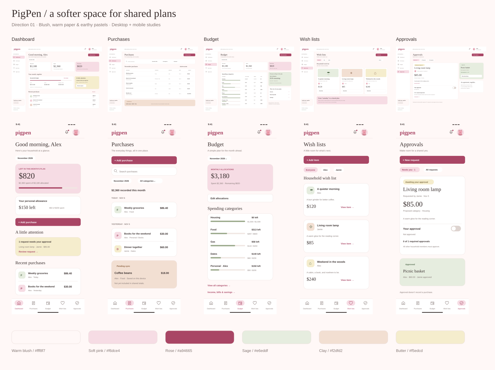

# PigPen UI design reference

Direction 01 was accepted as the visual reference on November 6, 2026. Use these static mockups to guide the first UI implementation.

- [Full-size review gallery](../design/ui-v1/index.html): desktop and mobile views of Dashboard, Purchases, Budget, Wish lists, and Approvals, plus separate notification-list examples. Open the HTML file in a browser.
- [Overview image](../design/ui-v1/overview.png).
- [Design notes and rebuild instructions](../design/ui-v1/README.md): confirmed direction, sample data, provisional behavior, and verification limits.

## Accepted visual direction

Gusto-inspired spacing and serif headings, a very light pink background, light pink and deeper rose accents, rounded cards, and earthy sage, clay, and butter pastels. Reuse the existing PigPen pig avatars.

Give all five main destinations equal prominence. Desktop uses a sidebar; mobile uses bottom navigation. Notifications have a separate list accessed from the corner bell. Wish lists use one household view filtered by owner. Keep the budget simple and within the documented product scope.

For now, approvals assume every active household member other than the requester must approve. This replaces the earlier one-reviewer proposal for this design reference; retain its provisional status until implementation rules are finalized.

## Reference boundaries

Acceptance establishes the visual direction. Sample names, amounts, dates, currency, and illustrative controls do not confirm previously open product rules. Consult [functionality](functionality.md) and the [design notes](../design/ui-v1/README.md) for that distinction.

The saved set includes editable SVGs and rendered PNGs at `design/ui-v1/`. It is static artwork, not an implemented application. Forms, detail screens, additional UI states, tablet adaptation, accessibility, and real-device behavior still need subsequent work.

## Dark appearance — November 8, 2026

Confirmed user request: Settings uses a gear icon, and includes dark mode. In dark mode the existing pink logo/header area stays the same; the application below it uses dark backgrounds and light, readable text. Cards, navigation, forms, dialogs and status colors follow the appearance preference.

Implementation choice: light mode remains the default until enabled. The Settings → Appearance → Dark mode switch applies immediately and is remembered per browser/device, independently of household financial data. It also follows changes made in another tab. Storage failure does not prevent changing appearance for the current session. The separate pink profile-entry screen retains its existing appearance.

## Purchase spending overview — November 8, 2026

Confirmed request: replace the purchases month dropdown with one visible month, horizontal swipe navigation, a large monthly spending total, and one bar per week. Tapping a bar shows the week's spending and category breakdown, inspired by the supplied iPhone Screen Time reference.

Implementation choices: weeks run Monday–Sunday and are clipped to the visible month, so adjacent months never contribute to its total. The chart uses stacked category colors; all totals and the purchase list follow the existing category/purchaser filters. A selected week also filters the purchase list; tap it again or choose Show full month to clear selection. Month changes clear the week selection. Previous/next buttons and keyboard-operable week buttons provide alternatives to touch gestures. Empty weeks remain selectable. This uses the existing synchronized purchase/category records with no JSON contract or dependency change. TODO: confirm actual iPhone gesture feel on device.

Purchase month motion follow-up, November 8: confirmed request for a smooth horizontal transition inspired by iPhone Screen Time. Implementation choice: a 380ms ease-out slide moves the outgoing and incoming month's total, weekly chart and category breakdown together in the navigation direction, clipped within the card. Briefly guard navigation during the slide; departing content is inert and hidden from assistive technology. Reduced-motion preference skips the animation. Arrow and swipe navigation share the same transition. Actual iPhone motion feel remains device acceptance.

Purchase swipe boundary/response follow-up, November 8: user requested stopping at the current week, faster swipe-animation onset, and removal of Purchased by above the summary. Since the pager displays months, forward navigation now stops at the current month (America/New_York, matching transaction-date conventions); future week bars within it remain visible but disabled. A remembered future month is corrected when opening Purchases. Purchased by and its filtering state are removed; category filtering, including parent/child matching, remains. Implementation choice: recognize a horizontal gesture at 18px during pointer movement, rather than waiting for release at 50px, and settle the slide in 280ms. Vertical gestures cancel month navigation. One month changes per gesture; reduced-motion handling remains. Actual iPhone feel remains a device check.

## Thinking-pig loading state — November 8, 2026

Confirmed request: create a dedicated loading asset similar to the empty state, showing the pig mascot thinking, and use it throughout the app. Implemented as `assets/states/pig-thinking.svg`, derived from the existing mascot's vector outlines and palette, with an upward gaze, hoof at its chin, and dotted thought bubble. `AppLoading.vue` provides full-size and compact presentations, contextual status text, decorative image semantics and polite announcements. A gentle thinking motion respects reduced-motion preferences; the standalone asset remains static.

Startup uses the full-size version. Synchronization, pull-to-refresh, dialog submissions (including retries), household setup, comments, receipt upload, saved-action retries and notification settings use compact versions. Background synchronization does not move page content, and its indicator is hidden while pull-to-refresh displays the same status. Queued/offline actions retain their existing messages rather than suggesting active loading. No API contract or dependencies changed.

Loading follow-up, November 8: confirmed exception—the pull-down sync/update gesture uses the previous 12-spoke loading wheel, with screen-reader status text. Other loading feedback retains the thinking pig. Startup is centered horizontally and vertically in the viewport with a 440px maximum card width and safe-area padding; compact pig/text rows align on their vertical centers. The background sync pig stays hidden during pull-down refresh. Reduced-motion handling remains in both presentations.

Purchase forward-limit feedback, November 8: confirmed request for a small movement revealing only background when attempting to swipe beyond the current week. At the current-month boundary the summary now follows horizontal forward drags with resistance, capped below 52px, exposing the card background without rendering another month. Release, touch cancellation or lost pointer capture returns it smoothly over 320ms. Month, totals and selection stay unchanged; accidental bar clicks after dragging are suppressed. Reduced-motion preference removes the displacement/return animation. Earlier-month navigation keeps its existing slide. Actual iPhone feel remains device acceptance.

Wish item detail centering — November 8, 2026 (confirmed request): center the wish item detail dialog vertically in the overall viewport on mobile and desktop. Keep its bounded height and internal scrolling for long descriptions/comments. Other dialogs retain their existing positioning.

Profile editing — November 8, 2026 (confirmed request): each profile card has an Edit hyperlink in its top-right corner. It opens a dedicated page with the editable display name and avatar controls. Delete profile appears below the editor and requires a confirmation message. Implementation retains the existing archival behavior: deletion removes the profile from selection while preserving financial history, and the last active profile cannot be deleted. Opening the editor selects that profile to satisfy the existing self-edit API rule. Editing and deletion require connectivity. Automatic app activation is deferred while the profile editor is open.

Icon action buttons — November 8, 2026: confirmed request to use an edit icon for category editing in Manage categories, and plus icons for the Purchases, Approvals and Wish lists heading actions. Keep accessible action names, hover titles, existing behavior/disabled states and 44px touch targets.

Profile Edit icon follow-up — November 8, 2026 (confirmed request): replace the text Edit link with the existing pencil icon, aligned with the profile name. Remove the separate top action row and its excess padding. Retain the accessible Edit [name] label, hover title, 44px target and dedicated edit page. Profile choice and editing remain separate controls; the card selection button covers the card with the edit link above it.

Budget chart layout follow-up, November 8: confirmed request for a larger donut with the key in balanced columns underneath, adapting to category count. Implementation choice: center the donut at up to 400px (320px on phones), then fit one to four legend columns to the card width. Distribute entries evenly across rows and center shorter rows; keep category order and allow long labels to wrap. ResizeObserver recalculates the layout when available width changes. No dependency or API changes.

Shared edit icon — November 8, 2026 (confirmed request): use a pencil in a square throughout the app in place of the simple pencil. The shared AppIcon edit path updates profile and category edit icons together. Existing accessible labels, targets and actions remain.

Budget wheel selection follow-up, November 8: confirmed request to reduce the previous donut to 75% and allow tapping/dragging around it to select a category with a small category/amount/percentage callout. Implementation: 75% of available width with 300px desktop and 240px phone caps; preserve the balanced key underneath. Start pointer selection on the ring and capture the pointer so dragging continuously selects by clockwise angle. Selected slices are emphasized and the callout persists after release. Arrow keys, Home/End and Escape provide keyboard selection/clearing. Callout percentages use expected income even when the wheel geometry uses total allocations in an over-budget plan; zero income shows “No expected income set.” Empty charts have no selectable segments. Mark the wheel as touch-interactive so the page's pull-to-refresh ignores its touch gesture. No API or dependency changes.

Budget wheel focus follow-up, November 8: confirmed request to remove the blue border after tapping. Suppress the SVG browser outline and WebKit tap highlight for pointer interaction. Keep the themed focus indicator for keyboard navigation, including switching back to keyboard after tapping; pointer interaction also clears a prior keyboard outline.

Budget deselection and key order, November 8: confirmed requests to tap back out of chart selection and read the key top-to-bottom, then left-to-right. A primary pointer press outside the wheel or in its center/empty area now clears selection, hides the callout and restores all segment colors; dragging around the ring still selects continuously. The document outside-pointer listener is removed on component unmount. Legend entries retain the existing category sequence and fill balanced columns downward, then across, with column heights differing by at most one. This supersedes the earlier row-first arrangement/centering choice.

Manage categories layout — November 8, 2026 (confirmed request): show subcategories as indented line items inside their parent category container, remove Available labels and the introductory paragraph, use the existing pink plus-icon button aligned right directly above the list, and reduce category edit buttons and icons to 80% of their prior dimensions (35.2px button, 14.4px icon). Archived labels and individual edit, add-subcategory, restore and swipe-delete actions remain. This supersedes the earlier 44px category edit-button choice on this dialog. No dependency or API changes.

Manage categories parent actions — November 8, 2026 (confirmed follow-up): keep the parent edit button aligned right on the category-name row and move + Add subcategory to the bottom of its parent container, below all child line items. Use a flexible name column with a separate actions column so the edit control stays on the same row at phone widths.

Budget key selection, November 8: confirmed request to remove percentages from the key and let users tap its categories to highlight the matching donut slice and show dollars/percentage below. Key entries are now native buttons containing a color marker and name, with a pressed state shared with wheel selection. Column-first order and balanced columns remain. Callout percentages still use expected income. Zero-allocation categories can be selected through the key and show $0/0% (or no expected income); they have no slice to highlight and leave visible slices undimmed. Pointer interaction within the key selects without dismissing the callout; outside/center taps and Escape dismiss it. Data changes reset stale selection. No dependencies/API changes.

Budget key compact spacing, November 8: confirmed request to restore the pre-button vertical spacing. Remove the category buttons' 44px minimum height and 6px/8px padding, retaining natural text-height entries and the original 14px row gap. Native button selection and column-first order remain. This supersedes the tappable key's previous 44px target implementation choice.

Budget key selected color, November 8: confirmed request for bold selected category names to match the active bottom navigation's dark pink. Use the same --rose color token for the pressed key button; retain its bold weight and compact spacing.

Budget center details, November 8: confirmed request to place selected-category details in the donut's center instead of below it, replacing expected income while selected, and trim the hint/callout space. Selection now shows category name, fitted dollar amount and percentage in the center; deselection restores expected income. Removed the separate feedback area and exploration hint entirely; the compact key follows the wheel with its existing gap. Long center labels wrap to two lines with ellipsis/title, with the full category/amount/expected-income-percentage available to assistive technology. Percentages still use expected income; zero income is labeled explicitly. Unchanged background snapshots preserve selection; actual category/income/allocation changes clear it. No dependencies/API changes.

Show cents setting — November 8, 2026: confirmed request to show or hide cent values from Settings. Implementation choice: a Show cents switch in Appearance, enabled by default and remembered on this device (shared with other open tabs on the same origin). Turning it off rounds displayed currency to the nearest whole dollar throughout the app; saved amounts, calculations, and editable amount fields keep exact cents. Missing/unavailable storage defaults to showing cents. No API contract or dependency changes.

Thinking-pig anatomy correction — November 8, 2026: the raised thinking hoof replaces the mascot's right front leg rather than adding another limb. Removed that leg's resting outline/hoof, reshaped the bent foreleg and added its matching cloven hoof at the chin. Three legs rest on the ground and one front hoof is raised. Centering, reduced motion and the pull-down wheel remain unchanged.

Generic loading label — November 8, 2026 (confirmed): every thinking-pig indicator says exactly “Loading...” in full-size and compact usage. AppLoading owns this text; removed per-context label overrides including startup's “Loading PigPen…”. Pull-down sync/update retains its wheel and existing screen-reader instructions.
